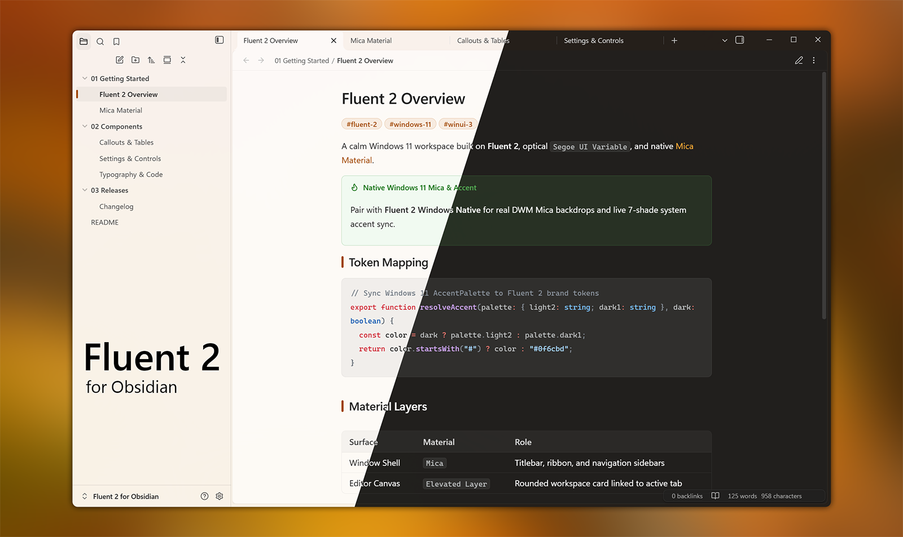
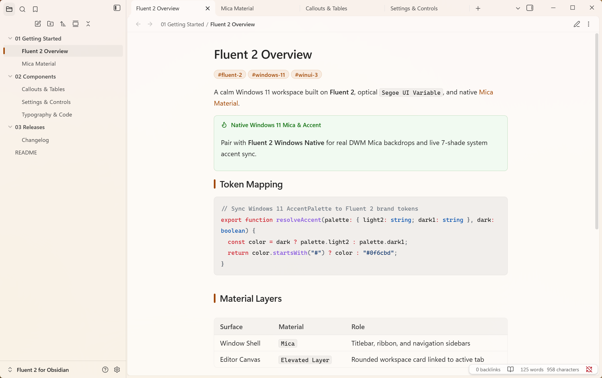
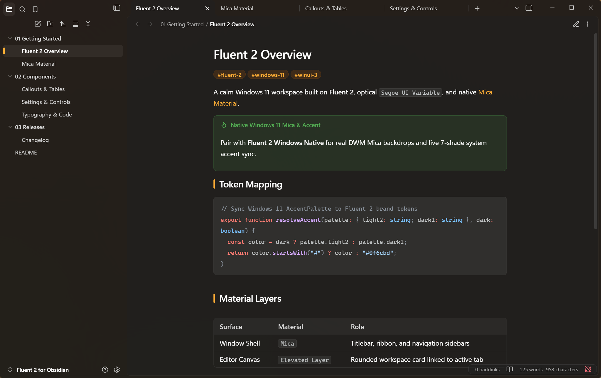
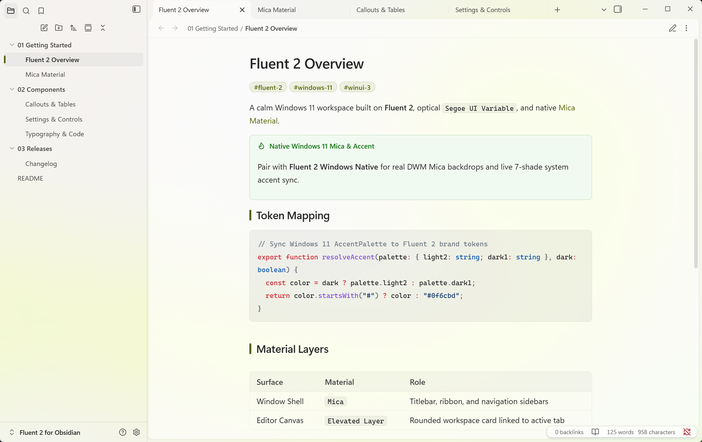
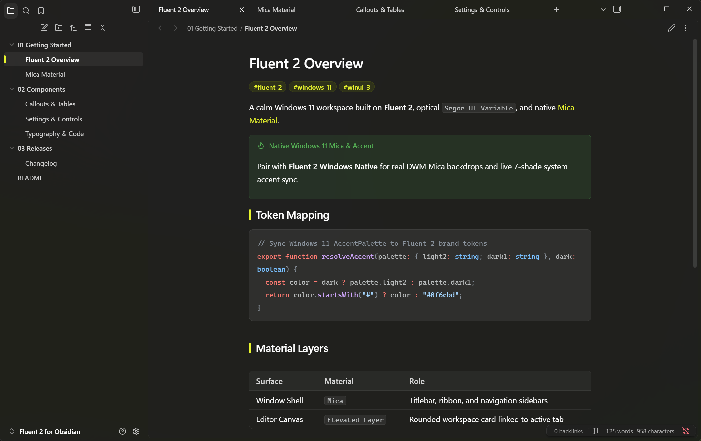
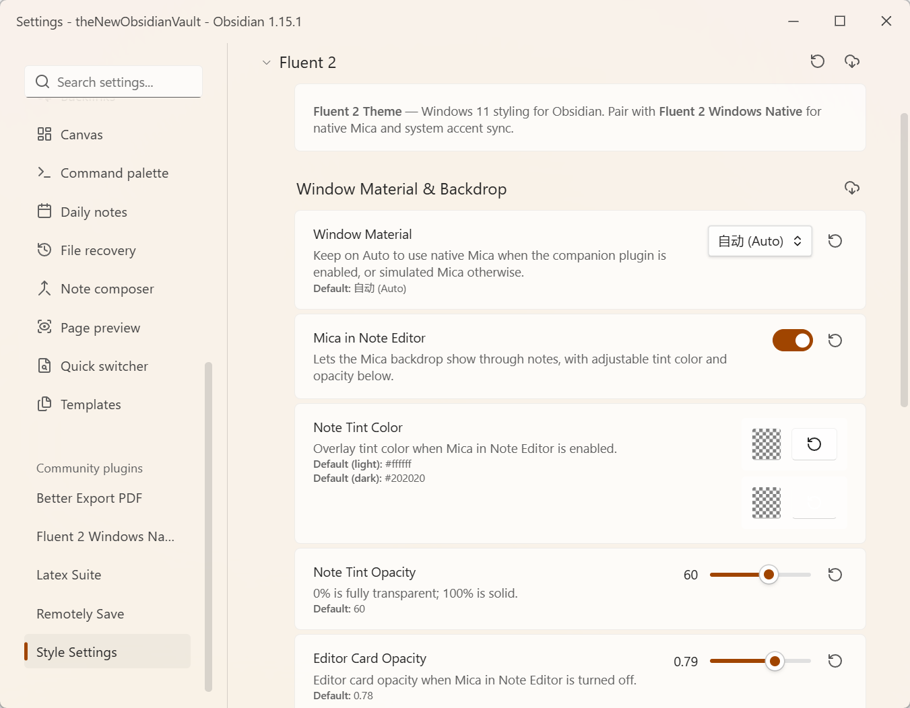

# Fluent 2 for Obsidian

[简体中文](#简体中文) | [English](#english)



---

## 简体中文

基于微软 **Fluent 2 Design System**（[Fluent UI v9](https://fluent2.microsoft.design/) 与 Windows 11 WinUI 3）打造的 Obsidian 主题。完整还原微软官方设计令牌与 Windows 11 材质层级，并深度适配 Windows 11 原生云母材质与系统主题色体验。

配套原生插件：[Fluent 2 Windows Native](https://community.obsidian.md/plugins/fluent-windows-native)（提供 Windows 11 原生 Mica / Mica Alt / Acrylic 材质与 7 阶系统主题色自动同步）。

### 界面预览

云母材质与系统强调色会随 Windows 11 桌面壁纸与个性化配色自动变化：

| 浅色模式（暖棕壁纸与系统强调色） | 深色模式（暖棕壁纸与系统强调色） |
| :---: | :---: |
|  |  |
| **浅色模式（青绿壁纸与系统强调色）** | **深色模式（青绿壁纸与系统强调色）** |
|  |  |

| Windows 11 风格独立设置窗口与 Style Settings 面板 |
| :---: |
|  |

### 核心特性

#### 1. 官方 Fluent 2 设计令牌体系
- **语义色板与品牌色阶**：完整映射 `@fluentui/tokens` 的 `webLightTheme` 与 `webDarkTheme`（`colorNeutralBackground1–6`、`colorNeutralForeground1–4`、`colorNeutralStroke1–3`、`brandWeb` 10–160 色阶）。
- **物理阴影与动效**：内置双层环境光加关键光阴影（`shadow2` 至 `shadow64`）、Fluent 2 标准圆角标尺与贝塞尔缓动曲线（`curveDecelerateMid`、`curveEasyEase` 等），自动遵循系统「减弱动态效果」设置。
- **Windows 11 字体排版**：默认优先使用 Windows 11 内置可变字体 `Segoe UI Variable`（支持光学字号自适应）与 `Microsoft YaHei UI` 中文协调回退；行内代码与代码块统一遵循 Obsidian「外观 → 等宽字体」设置（默认回退至 `Cascadia Code`）。

#### 2. WinUI 3 界面层级与控件细节
- **层叠窗口架构**：标题栏、功能区（Ribbon）与左右侧边栏位于底层云母外壳（Shell），主编辑区以四边圆角的悬浮卡片承载，与激活标签页无缝打通；窗口最大化时支持鼠标顶到屏幕最上方直接点击标签页。
- **标志性 Fluent 2 控件**：
  - 侧边栏文件树、大纲、设置导航与功能区激活项左侧带平滑动效的 **3px 垂直药丸指示条**。
  - 输入框与搜索栏采用 Windows 11 纯平底部聚焦指示线（两端不上翘）。
  - 严格对齐 Windows 11 系统设置比例的 **40×22px 切换开关**、带微斜角描边的按钮、WinUI 3 滑块与复选框。
  - 独立设置窗口还原 **Windows 11 设置风格**：44px 左对齐常规字重标题栏、无纯色容器底框的半透明设置卡片，以及常规字重的微软雅黑 UI / Segoe UI 标题。
  - 亚克力毛玻璃（Acrylic）右键菜单、命令面板、快速切换、悬浮预览与图谱控制面板。

#### 3. Markdown 与代码阅读体验
- **VS Code 2026 语法高亮**：代码块配色完整沿用 Visual Studio Code 默认的 **2026 Light** 与 **2026 Dark** 方案，同时覆盖阅读视图（Prism）与实时预览。
- **正文透出云母与可调底色**：默认开启「笔记正文透出云母背景」，让编辑区与阅读区也自然透出底层云母材质，支持在 Style Settings 中自由调节叠加底色与 `0%`–`100%` 不透明度（也可随时关闭切换回高不透明度卡片）；表格表头、引用块、代码块与属性卡片自动采用统一的微透明内嵌层次。
- **Fluent 2 内容组件**：默认开启 H1/H2 左侧强调色竖条装饰（可在 Style Settings 切换为无装饰或底部分割线），内置 MessageBar 风格 Callout 提示框、DataGrid 风格表格与 Obsidian Bases 视图、Expander 卡片风格笔记属性、圆角药丸标签。

### Windows 11 原生特性支持矩阵

| Windows 11 特性 | 纯主题 CSS 支持 | 实现方式与说明 |
| :--- | :--- | :--- |
| **Mica / Mica Alt / Acrylic 原生云母材质** | 需搭配插件或 DWM 工具 | 纯 CSS 无法直接调用 Electron 窗口材质接口。搭配 [Fluent 2 Windows Native](https://community.obsidian.md/plugins/fluent-windows-native) 插件可为主窗口及 Obsidian 1.15+ 独立设置窗口启用原生云母；未安装插件时自动回退为纯 CSS 拟真云母（Simulated Mica）。 |
| **Windows 11 系统个性化主题色** | 需搭配插件或手动拾色 | Windows 下 Electron 内核的纯 CSS `AccentColor` 通常回退为默认蓝。安装 [Fluent 2 Windows Native](https://community.obsidian.md/plugins/fluent-windows-native) 可直接读取系统注册表 `AccentPalette` 完整 7 阶色板并实时同步；也可在 Style Settings 中使用自定义品牌色拾色器自动推导全套色阶。 |
| **Segoe UI Variable 与 Cascadia Code** | 原生支持（纯 CSS） | 自动调用 Windows 11 内置可变字体与等宽字体，支持光学字号自适应。 |
| **Windows 对比度主题（High Contrast）** | 原生支持（纯 CSS） | 通过 `@media (forced-colors: active)` 完整兼容 Windows 水生、沙漠、黄昏、夜空等对比度主题。 |
| **系统「减弱动态效果」** | 原生支持（纯 CSS） | 通过 `@media (prefers-reduced-motion: reduce)` 自动关闭过渡与入场动效。 |
| **窗口控制按钮与 Snap Layouts** | 依赖窗口边框设置 | 隐藏标题栏模式下还原 Windows 11 经典三键（含 `#c42b1c` 红色关闭悬停）；如需悬停最大化按钮触发原生 Snap Layouts，可在「设置 → 界面 → 窗口边框样式」切换为原生边框。 |

### 安装与使用

1. **安装主题**：从 Obsidian 社区主题市场安装，或克隆本仓库到 `.obsidian/themes/Fluent 2/` 目录下（文件夹名需与 `manifest.json` 中的 `"name": "Fluent 2"` 一致）：
   ```bash
   git clone https://github.com/zyraxi21/Fluent-2-Obsidian.git "Fluent 2"
   ```
   随后在 **设置 → 外观 → 主题** 中选择 **Fluent 2**。
2. **浅色、深色与跟随系统设置**：请在 Obsidian 原生的 **设置 → 外观 → 基础颜色** 中切换 **适应系统 / 浅色 / 深色**。主题未在 Style Settings 中重复提供明暗切换项，以确保 Windows 11 原生云母材质、第三方插件与界面色板始终保持一致。
3. **开启原生 Windows 11 Mica 与系统主题色（推荐）**：安装配套插件 [Fluent 2 Windows Native](https://community.obsidian.md/plugins/fluent-windows-native) 并在 **设置 → 界面 → 窗口边框样式** 保持 **隐藏（默认）**。
4. **通过 Style Settings 进阶定制（可选）**：安装 **Style Settings** 插件后，可自由调节窗口材质模式、正文云母叠层颜色与不透明度、强调色来源、标题样式、图片下方说明与紧凑侧边栏密度。

### 已知问题

- **开启原生 Mica 材质后右键菜单无法呈现亚克力毛玻璃模糊**：由于 Electron / Chromium 的底层合成限制，当窗口启用 Windows 11 原生 `setBackgroundMaterial`（Mica / Mica Alt / Acrylic）时，页面内的 CSS `backdrop-filter` 高斯模糊会整体失效。为保证文字清晰可读，主题在检测到原生云母开启时，会自动将右键菜单、命令面板、悬浮预览与弹窗切换为接近不透明的亚克力回退底色（与 Windows 关闭透明效果时的系统表现一致）；关闭原生云母（使用拟真云母或纯色模式）时，右键菜单与浮层仍正常显示高斯模糊效果。

---

## English

An Obsidian theme built on Microsoft's **Fluent 2 Design System** ([Fluent UI v9](https://fluent2.microsoft.design/) and Windows 11 WinUI 3). It faithfully maps official Fluent 2 design tokens, elevation shadows, motion curves, and layered material hierarchy, with deep support for native Windows 11 Mica and system accent colors.

Companion plugin: [Fluent 2 Windows Native](https://community.obsidian.md/plugins/fluent-windows-native) (enables native Windows 11 Mica, Mica Alt, and Acrylic window materials plus live 7-shade Windows 11 system accent color synchronization).

### Screenshots

Mica backdrops and accent ramps adapt dynamically to your Windows 11 desktop wallpaper and system accent color:

| Light Mode (Warm Amber Wallpaper & Accent) | Dark Mode (Warm Amber Wallpaper & Accent) |
| :---: | :---: |
|  |  |
| **Light Mode (Olive Green Wallpaper & Accent)** | **Dark Mode (Olive Green Wallpaper & Accent)** |
|  |  |

| Windows 11 Standalone Settings Window & Style Settings |
| :---: |
|  |

### Key Features

- **Authentic Fluent 2 Design Tokens**: Maps `webLightTheme` and `webDarkTheme` tokens from `@fluentui/tokens` (neutral surfaces `1–6`, foregrounds, strokes, `brandWeb` color ramp `10–160`, dual-layer ambient/key shadows `shadow2`–`shadow64`, corner radii, and physical Bezier motion curves).
- **Windows 11 WinUI 3 Layering & Controls**:
  - Elevated rounded editor card seamlessly connected to active tabs with Edge-style concave bottom fillets and top-edge (`y = 0`) Fitts's Law click support when maximized.
  - Signature 3px vertical brand pill indicators on active sidebar, outline, ribbon, and settings items.
  - Flat Windows 11 bottom focus indicator on text inputs, 40×22px WinUI 3 toggle switches, subtle beveled buttons, acrylic popovers/menus/command palette, and Windows 11 Settings styling (translucent cards, left-aligned 44px regular-weight titlebar, and clean headings).
- **Windows 11 Native Materials & Note Editor Mica**:
  - Works out of the box with a full-window pure-CSS Simulated Mica fallback; automatically switches to native Mica layering when translucency (`body.is-translucent`) is enabled via [Fluent 2 Windows Native](https://community.obsidian.md/plugins/fluent-windows-native).
  - Note Editor Mica is enabled by default with an adjustable solid tint color and opacity (`0%`–`100%`) in Style Settings, paired with harmonized translucent tables, blockquotes, code blocks, and properties.
- **VS Code 2026 Syntax Highlighting**: Uses Visual Studio Code's default **2026 Light** and **2026 Dark** token palettes across Reading View and Live Preview, while respecting Obsidian's configured monospace font in both code blocks and inline code.
- **Accessibility**: Built-in support for Windows Contrast Themes (`@media (forced-colors: active)`) and OS Reduced Motion (`@media (prefers-reduced-motion: reduce)`).

### Installation & Usage

1. Install **Fluent 2** from Obsidian's Community Themes browser (or clone this repository into `.obsidian/themes/Fluent 2/`):
   ```bash
   git clone https://github.com/zyraxi21/Fluent-2-Obsidian.git "Fluent 2"
   ```
2. Select **Fluent 2** in **Settings → Appearance → Themes**.
3. **Light / Dark / Follow System**: Configure your color scheme directly in Obsidian's built-in **Settings → Appearance → Base color scheme** (**Adapt to system / Light / Dark**). This is intentionally not duplicated in Style Settings so that native Windows 11 Mica light/dark tint, community plugins, and theme tokens always stay in sync.
4. *(Recommended on Windows 11)* Install [Fluent 2 Windows Native](https://community.obsidian.md/plugins/fluent-windows-native) to enable native Windows 11 Mica / Mica Alt / Acrylic (including Obsidian 1.15+ pop-out Settings windows) and live 7-shade system accent sync. Keep **Settings → Interface → Window frame style** set to **Hidden (default)**.
5. *(Optional)* Install **Style Settings** to customize window material modes, Note Editor Mica overlay color and opacity, accent presets, heading styles, centered image captions, compact sidebar density, and motion.

### Known Issues

- **Context menus cannot render frosted Acrylic blur while native Mica is enabled**: Due to an Electron / Chromium compositing limitation, enabling native Windows 11 `setBackgroundMaterial` (Mica / Mica Alt / Acrylic) disables CSS `backdrop-filter` blur across the window. To keep menus and flyouts legible, Fluent 2 automatically switches context menus, the Command Palette, popovers, and dialogs to a near-opaque acrylic fallback whenever native Mica is active (matching Windows behavior when transparency effects are unavailable). When native Mica is off (Simulated Mica or Solid mode), standard CSS Gaussian blur works normally.

### References & License

- [Fluent 2 Design System](https://fluent2.microsoft.design/)
- [microsoft/fluentui](https://github.com/microsoft/fluentui) (`@fluentui/tokens`)
- [Visual Studio Code 2026 Light / Dark Theme](https://github.com/microsoft/vscode)
- Licensed under [GNU General Public License v3.0](LICENSE).
